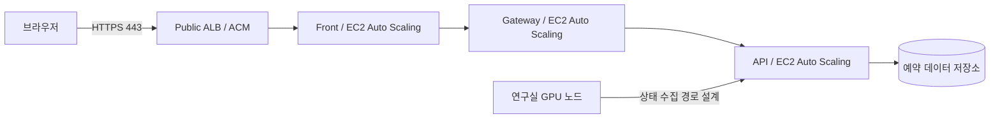

# 연구실 GPU 서버 자원 예약 및 실시간 모니터링 시스템

연구실이 보유한 GPU 서버·노드의 실제 상태를 확인하고, 캘린더에서 사용 시간을 예약하는 웹 서비스입니다. 연구원과 팀원은 자원을 예약하고 본인의 사용 이력을 확인하며, 관리자는 소속 연구실의 자원·회원·예약 정책을 운영합니다.

2026학년도 2학기 웹 프로그래밍 텀프로젝트로 개발합니다. 기능 구현과 함께 AWS Infrastructure Composer와 CloudFormation을 이용한 IaC, 다중 가용 영역 배치, EC2 Auto Scaling을 설계 범위에 포함합니다.

> 현재는 서비스 초기 구성을 진행하는 단계입니다. 아래 기능과 HA 아키텍처는 구현 목표이며, 운영 배포·장애 복구·부하 테스트를 완료했다는 의미는 아닙니다.

## 개발 일정

모든 마감은 한국 표준시(KST, UTC+09:00) 기준입니다.

| 제출 단계 | 마감 | 목표 산출물 |
| --- | --- | --- |
| 프론트엔드 | 2026-11-06 23:59 | HTML·CSS 화면, 공통 레이아웃, 반응형 UI |
| JavaScript | 2026-11-20 23:59 | 화면 동작, 입력 검증, 목업 데이터를 이용한 기능 검증 |
| 백엔드 | 2026-12-04 23:59 | API·데이터 저장·실시간 처리 구현과 실제 연동 |

JavaScript 단계에서는 API 요청·응답 형식을 먼저 정하고 목업 데이터로 화면 동작을 검증합니다. 백엔드 단계에서 실제 API로 전환하고 통합 검증합니다. 상세 WBS와 인프라 검증 일정은 별도로 구체화할 예정입니다.

## 주요 기능

| 기능 | 개발 범위 | 관련 화면 |
| --- | --- | --- |
| 회원·인증 | 연구실 초대 코드 가입, 이메일 인증, 로그인, 일반 사용자·관리자 권한 분리 | C01–C03, A01 |
| 자원 모니터링 | GPU 서버·노드 목록과 상세, 실제 상태, 마지막 수신 시각, 연결 이상 표시 | U01–U02, O01–O02 |
| 예약 | 캘린더 조회, 등록·수정·취소·조기 종료, 중복 예약과 연속 점유 제한 | U03–U06 |
| 알림 | 예약 시작·종료 임박, 조기 종료 대기 알림, 운영 취소 알림, 읽음 처리 | U08 |
| 관리자 운영 | 자원 등록·수정·점검, 회원·초대 코드·예약 정책 관리 | O01–O02, A01–A02 |
| 이력·통계 | 본인 예약 이력, 자원별·회원별 예약 시간과 예약 가동률 | U07, A03 |
| 반응형·접근성 | 모바일 대시보드와 예약 입력, 키보드 접근, 오류·로딩·빈 결과 표현 | M01–M02 및 공통 화면 |

### 서비스 규칙

- 모든 조회·변경은 로그인 회원의 소속 연구실과 권한을 기준으로 제한합니다.
- 예약 정보와 실제 GPU 사용 상태를 구분합니다. 예약 시작·종료가 GPU 작업의 자동 실행·강제 중지를 뜻하지 않습니다.
- 조기 종료 대기는 알림 신청입니다. 자동 예약이나 우선 배정은 제공하지 않습니다.
- 예약 중복과 권한은 저장 시점에 서버에서 다시 검사합니다. 연속 예약을 합산하여 점유 제한을 확인합니다.
- 상태 수신이 끊기면 마지막 값과 수신 시각을 유지하고 연결 확인 필요 상태로 표시합니다.
- 통계는 예약 시간 기준이며 실제 GPU 연산 부하와 구분합니다.

예약 1시간 단위·최대 연속 8시간, 시작·종료 10분 전 알림 등은 UI 설계서의 제안값입니다. 최종 운영 정책은 별도로 확정합니다. M01·M02는 U01·U04의 반응형 표현으로 구현합니다.

## 저장소 구성

| 저장소 | 역할 | 현재 상태 |
| --- | --- | --- |
| [WP-TP-Front](https://github.com/2026-2-web-programming-term-project/WP-TP-Front) | Thymeleaf 화면, HTML·CSS·JavaScript, 백엔드 호출 | Spring Boot 초기 프로젝트 |
| [WP-TP-Gateway](https://github.com/2026-2-web-programming-term-project/WP-TP-Gateway) | 서비스 라우팅과 공통 요청 처리 | Spring Cloud Gateway 초기 프로젝트 |
| [WP-TP-API](https://github.com/2026-2-web-programming-term-project/WP-TP-API) | 인증·자원·예약·알림·관리·통계 API | Spring Boot 초기 프로젝트 |
| [WP-TP-DB](https://github.com/2026-2-web-programming-term-project/WP-TP-DB) | 데이터 모델, 스키마, 초기 데이터와 DB 운영 문서 | README·라이선스 |
| [WP-TP-Eureka](https://github.com/2026-2-web-programming-term-project/WP-TP-Eureka) | 서비스 등록·조회와 디스커버리 | README·라이선스 |
| [.github](https://github.com/2026-2-web-programming-term-project/.github) | 공통 소개, 일정, 설계 방향 | 공통 문서 |

상태는 2026-11-02의 기본 브랜치 파일을 기준으로 작성했습니다. 초기 프로젝트의 빌드·실행 및 서비스 간 연동은 별도 검증 대상입니다.

## 현재 기술 설정

| 항목 | Front | API | Gateway |
| --- | --- | --- | --- |
| Java toolchain | 25 | 25 | 25 |
| Spring Boot | 4.1.2 | 4.0.0 | 4.0.0 |
| Gradle Wrapper | 9.8.2 | 9.8.2 | 9.8.2 |
| 주요 설정 | Spring MVC, Thymeleaf, RestClient | Spring MVC, Security, JPA, OpenAPI | Spring Cloud 2025.1.4 |

버전은 각 저장소의 현재 빌드 설정 기록이며 호환성 검증 완료를 의미하지 않습니다. Gateway에는 WebFlux와 WebMVC starter가 함께 선언되어 있어 실행 방식을 선택할 예정입니다. 제안서는 MySQL을 예상 기술로 제시하며, API 초기 설정에는 MariaDB JDBC 드라이버가 선언되어 있습니다. 최종 DB 엔진과 관리 방식은 데이터·인프라 설계에서 정합니다.

## 인프라 설계 방향

### IaC와 변경 관리

AWS Infrastructure Composer로 구성을 시각화하고, 생성·수정한 CloudFormation YAML/JSON 템플릿을 Git으로 관리할 계획입니다. 환경별 파라미터, 리소스 의존성, 변경 검토와 재현 가능한 배포 절차를 문서화합니다. 템플릿의 저장 위치와 스택 분리 단위는 인프라 설계에서 확정합니다.

### HA와 수평 확장

다음은 목표 구성의 개념도입니다. AWS 리소스 생성이나 운영 가용성 검증은 아직 수행하지 않았습니다.

- 애플리케이션을 두 개 이상의 가용 영역에 분산하고, 계층별 부하와 의존성을 기준으로 EC2 Auto Scaling Group을 구성할 계획입니다.
- 외부 HTTPS 진입점은 ALB와 ACM 인증서를 사용하는 방안을 우선 검토합니다. 이 경우 브라우저 TLS 연결은 ALB에서 종료하며, 내부 구간의 암호화와 통신 허용 범위는 별도로 정의합니다.
- 서비스 간 통신은 내부 경로를 사용합니다. ASG 증감에 따른 주소 변경을 처리할 서비스 디스커버리 또는 내부 로드밸런싱 방식을 확정합니다.
- DB 장애 복구, 세션 상태, 알림 전달, 예약 스케줄러, Eureka의 단일 장애점을 함께 검토합니다. 애플리케이션 인스턴스 증설만으로 전체 서비스의 HA가 충족되었다고 판단하지 않습니다.
- 연구실 GPU 노드는 예약 대상 자원입니다. 웹 애플리케이션 ASG의 증설과 GPU 장비 수 증가는 별개의 용량 계획입니다.

### 검증할 항목

| 영역 | 확인할 내용 |
| --- | --- |
| 확장·축소 | 스케일링 지표·목표값, 인스턴스 기동 시간, readiness, 연결 종료 처리 |
| 장애 복구 | 인스턴스 종료·가용 영역 장애·DB 전환 시 복구와 요청 영향 |
| 예약 정합성 | 여러 API 인스턴스에서 동시 요청해도 겹치는 예약이 확정되지 않는지 확인 |
| 상태 관리 | 세션·파일·실시간 연결 상태를 특정 인스턴스에만 보관하지 않는 구성 |
| 알림·배치 | 다중 인스턴스에서 중복 알림·중복 예약 상태 처리가 발생하지 않는지 확인 |
| 성능 | 처리량, 동시 사용자, p95 응답 시간, 오류율, DB 연결과 병목 측정 |
| 운영 | 로그·메트릭·알람, 배포·롤백, 백업·복구 절차 |

트래픽 목표 수치와 합격 기준은 부하 시나리오를 정한 뒤 기록합니다. 현재 성능 수치는 측정하지 않았습니다. Cassandra·Redis·RabbitMQ 등 제안서의 추가 기술은 기능과 HA 요구에 따라 사용 여부·운영 방식을 결정합니다.

## 문서와 홈페이지

오거니제이션 프로필은 프로젝트 개요와 저장소 탐색을 제공합니다. GitHub Pages에는 주요 기능, 대표 UI, 인프라 개념도, 제출 일정을 소개하고 상세 설계·검증 결과는 관련 문서로 연결할 예정입니다. 실제 Spring 서비스의 배포 주소와 소개 페이지의 주소는 구분합니다.

제안서와 UI 설계서를 요구사항 근거로 사용합니다. 인프라 코드는 템플릿, 설계 이유, 실제 배포 결과를 함께 관리하고, 계획·구현·검증 상태를 구분합니다.

## 참고 자료

- [AWS Infrastructure Composer와 CloudFormation](https://docs.aws.amazon.com/AWSCloudFormation/latest/UserGuide/infrastructure-composer-for-cloudformation.html)
- [EC2 Auto Scaling의 다중 가용 영역 배치](https://docs.aws.amazon.com/autoscaling/ec2/userguide/as-add-az-console.html)
- [ALB HTTPS 리스너와 인증서](https://docs.aws.amazon.com/elasticloadbalancing/latest/application/create-https-listener.html)
- [EC2 Auto Scaling 목표 추적 정책](https://docs.aws.amazon.com/autoscaling/ec2/userguide/as-scaling-target-tracking.html)
- [Amazon RDS Multi-AZ 배포](https://docs.aws.amazon.com/AmazonRDS/latest/UserGuide/Concepts.MultiAZ.html)
